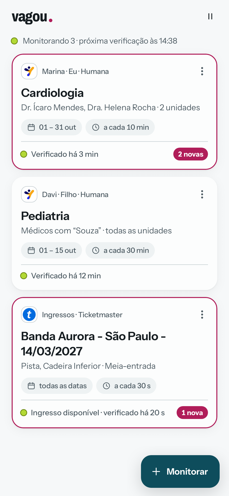
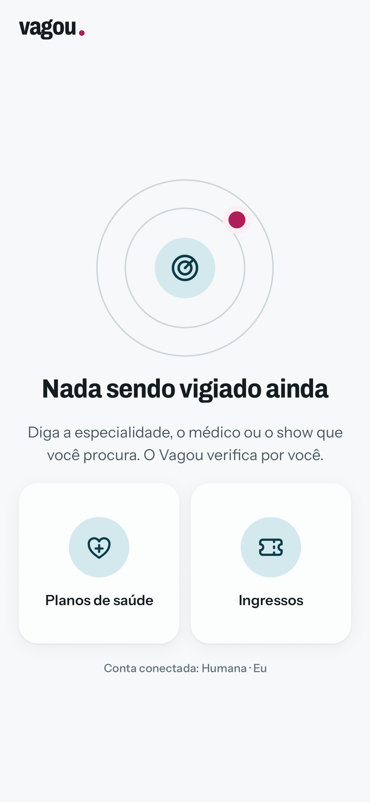
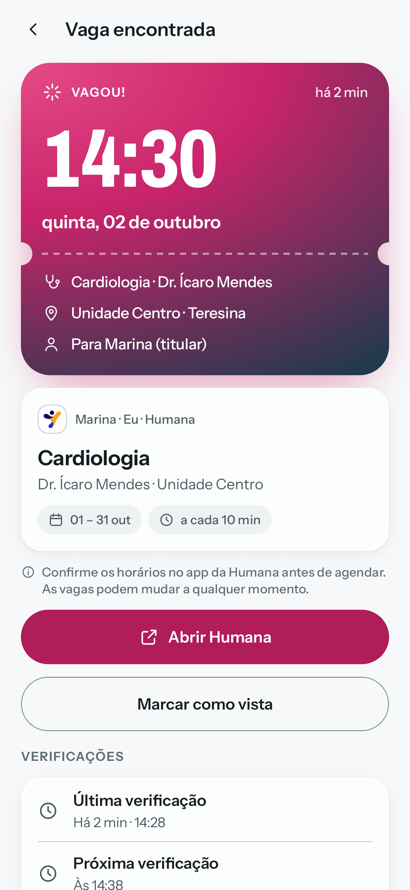
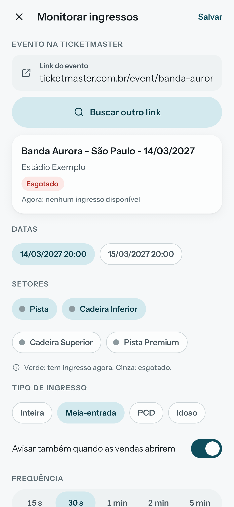
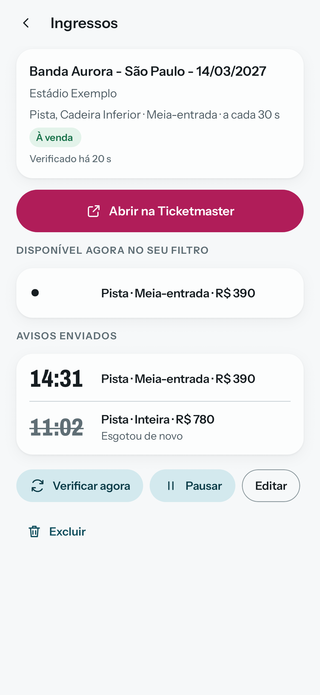
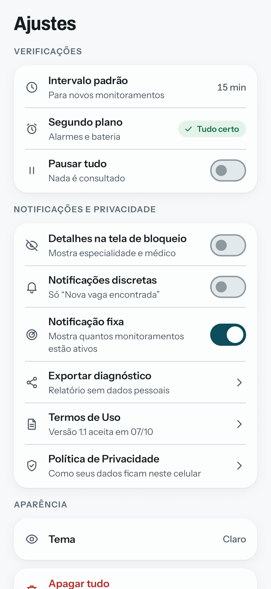

# Vagou

O Vagou avisa no seu celular quando abre um horário com o médico que você quer no seu plano de saúde, ou quando voltam
ingressos para o show que você quer na Ticketmaster.

<p align="center">
  
  
  
</p>
<p align="center">
  
  
  
</p>

## O que faz

Toque em **Monitorar** e escolha o que vigiar: **Planos de saúde** ou **Ingressos**.

### Consultas no plano de saúde

- Monitora a agenda do seu plano por especialidade e unidade, com os médicos que você escolher, qualquer médico ou quem tiver um nome que você digitar.
- Limita a busca por datas, dias da semana e horário.
- Verifica em segundo plano, mesmo com o app fechado, e avisa assim que surge uma vaga, com um atalho para o app oficial do plano.
- Mostra as vagas encontradas por dia e por médico, e o histórico do que foi verificado.
- Avisa quando a conta precisa de você (senha que não confere, conta bloqueada) ou quando o portal do plano está fora do ar.

### Ingressos na Ticketmaster Brasil

- Sem conta e sem login: cole o link do evento ou compartilhe com o Vagou.
- Escolha datas, setores e tipos de ingresso (Inteira, Meia-entrada, PCD, Idoso).
- Toca um alarme quando um ingresso que serve volta a ficar disponível ou quando a venda abre, e o aviso abre a página de venda. A compra é sempre sua.
- Verifica de 15 segundos a 5 minutos, com uma notificação fixa que mostra que está vigiando e permite pausar.

## Privacidade

Tudo roda no seu celular: sem servidor, sem cadastro, sem telemetria, anúncios ou rastreadores. Senhas e dados ficam
criptografados com uma chave do Android Keystore e fora dos backups. O Vagou só se conecta aos endereços oficiais do
plano e, para ingressos, às páginas públicas da Ticketmaster e à plataforma de venda que elas usam.

## Conexões

- Planos de saúde: Humana Saúde Nordeste (piloto)
- Ingressos: Ticketmaster Brasil

A Ticketmaster bloqueia acessos vindos de VPN. Para monitorar ingressos, desligue a VPN ou deixe o Vagou fora dela.

## Download

Baixe a versão mais recente em [Releases](../../releases/latest): o APK e o arquivo `SHA256SUMS`. As novidades de cada
versão estão no [CHANGELOG](CHANGELOG.md).

Para conferir um APK baixado:

```bash
shasum -a 256 -c SHA256SUMS
apksigner verify --print-certs vagou-X.Y.Z.apk
```

O certificado de assinatura oficial tem o SHA-256
`841f6c459fb4785baba52e9de745a8ee6288dd87aee56d8fe57f0fc8fdcb41c4`. Qualquer outro valor significa que o arquivo não é
uma versão oficial do Vagou.

## Aviso

O Vagou é um projeto independente e não é afiliado, patrocinado ou endossado pela Humana Saúde, por qualquer operadora
ou pela Ticketmaster. Os termos de uso da Ticketmaster proíbem robôs no site dela; monitorar ingressos é uma escolha sua,
por evento, e o acesso pode ser bloqueado a qualquer momento. As telas acima usam dados fictícios. Os horários vêm do portal do plano: confirme sempre no app oficial antes
de agendar. A disponibilidade de ingressos pode mudar a qualquer momento.

Este repositório só divulga o app (telas, novidades e downloads). O código-fonte é privado porque contém detalhes
sensíveis da integração com os portais dos planos suportados.
